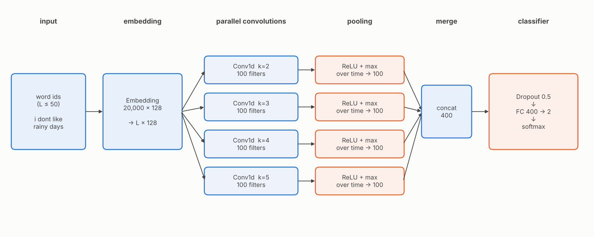
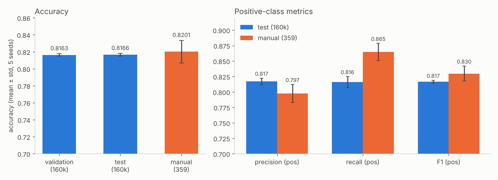
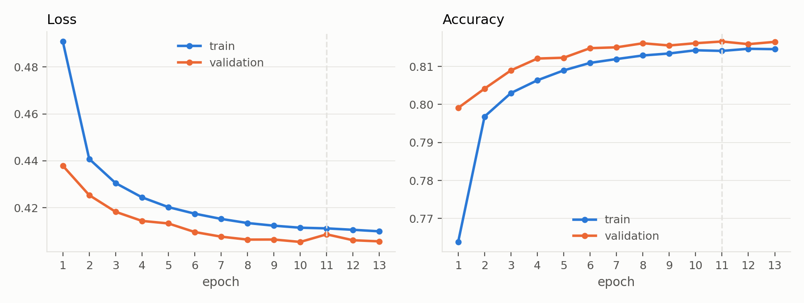
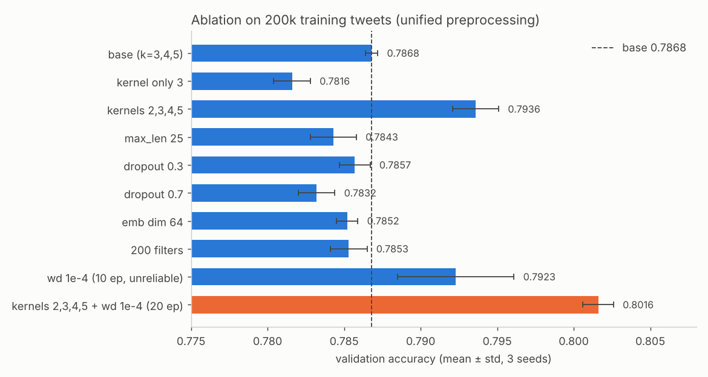
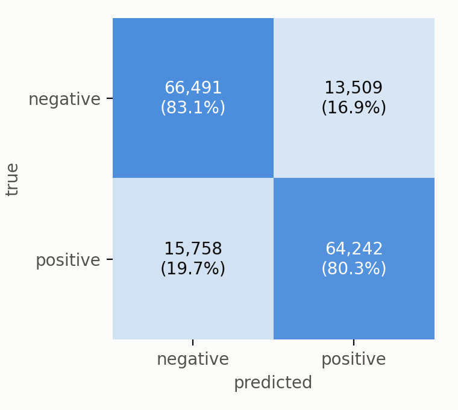
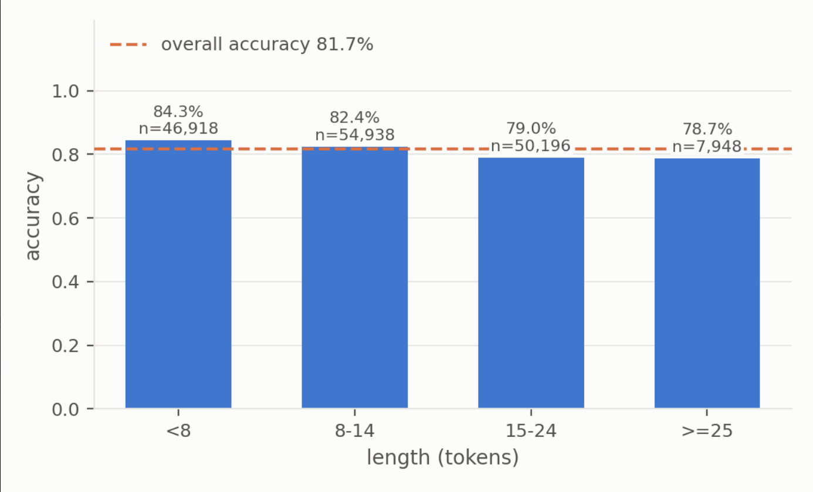
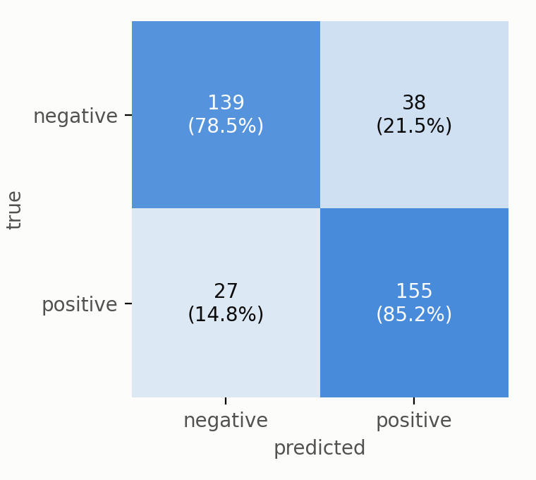
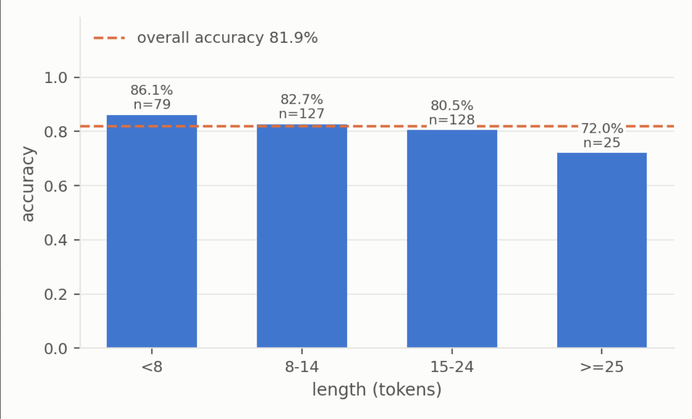

# TextCNN 实验结果

## 1. 实验协议（与组内对齐）

- 数据：Sentiment140，组内 `split_data.py` 的划分（80/10/10 分层随机，种子 42）：train 1,280,000 / val 160,000 / test 160,000；另有人工标注集 498 条，去掉中性 139 条后剩 359 条（177 负、182 正）。
- 输入：与组内 BiLSTM 一致的统一预处理（小写、去 @用户名 和网址、只留 a–z；词表 2 万；句长 50）。训练集句长中位 11、p99 27、最长 40，没有被截断。清洗会去掉撇号（isn't → isnt）和所有标点、表情符号。
- 调参只用验证集：消融阶段用前 20 万条训练 + 前 2 万条验证、3 个种子；测试集和人工测试集只在最终评估时用一次。
- 训练随机种子 0–4（与划分种子 42 无关）。

## 2. 最终配置

核宽 2/3/4/5（各 100 个滤波器），词向量 128 维（随机初始化），dropout 0.5，权重衰减 1e-4，Adam lr 1e-3，批大小 256，最多 20 轮，验证准确率连续 2 轮不提升早停并恢复最佳权重，128 万条全量训练。参数量 2,740,402。

## 3. 最终结果（5 个种子，均值 ± 标准差）

| 数据集 | 准确率 | 精确率(正) | 召回率(正) | F1(正) | macro-F1 | AUC |
|---|---|---|---|---|---|---|
| 验证集 16 万 | 0.8163 ± 0.0015 | 0.8179 ± 0.0051 | 0.8138 ± 0.0086 | 0.8158 ± 0.0024 | 0.8163 ± 0.0015 | 0.8965 ± 0.0012 |
| **测试集 16 万** | **0.8166 ± 0.0015** | 0.8170 ± 0.0053 | 0.8160 ± 0.0088 | 0.8165 ± 0.0024 | 0.8166 ± 0.0015 | 0.8973 ± 0.0014 |
| 人工测试集 359 | 0.8201 ± 0.0133 | 0.7975 ± 0.0146 | 0.8648 ± 0.0138 | 0.8297 ± 0.0122 | 0.8195 ± 0.0134 | 0.9106 ± 0.0074 |

要点：验证与测试几乎相同，没有对验证集过拟合；测试集正负类的精确率/召回率对称。人工集只有 359 条，准确率误差范围约 ±4 个百分点，不能说它比测试集更高；它上面召回率(正) 0.865 高于召回率(负) 0.774，模型对正面略偏，样本少，只能作为迹象。每轮约 33 秒（T4），5 个种子的最佳轮次 [11, 7, 5, 11, 11]。

训练曲线（种子 0，竖线为最佳轮次 11，第 13 轮早停）：

## 4. 消融（验证集，20 万训练 / 2 万验证，3 种子）

| 配置 | 准确率 | Δ | McNemar p（种子 0） |
|---|---|---|---|
| base（核 3/4/5，dropout 0.5，无 wd） | 0.7868 ± 0.0004 | - | - |
| 核只用 3 | 0.7816 ± 0.0012 | -0.0052 | <0.001 |
| 核 2/3/4/5 | 0.7936 ± 0.0015 | +0.0067 | 0.005 |
| 句长减半（25） | 0.7843 ± 0.0015 | -0.0025 | 0.371 |
| dropout 0.3 | 0.7857 ± 0.0010 | -0.0012 | 0.476 |
| dropout 0.7 | 0.7832 ± 0.0012 | -0.0036 | 0.002 |
| wd 1e-4（10 轮上限，不可靠） | 0.7923 ± 0.0038 | +0.0054 | 0.608 |
| 词向量 64 维 | 0.7852 ± 0.0007 | -0.0016 | 0.681 |
| 滤波器 200 | 0.7853 ± 0.0012 | -0.0016 | 0.647 |
| 核 2/3/4/5 + wd 1e-4（20 轮） | 0.8016 ± 0.0010 | +0.0148 | - |

全量数据验证集确认（128 万训练，16 万验证，1 个种子）：核 2/3/4/5 + wd 1e-4 = 0.8164（AUC 0.8971）；无 wd = 0.8151（AUC 0.8932）。权重衰减的收益从 20 万条时的约 +0.008 缩小到约 +0.001（单种子，未做显著性检验）。

结论：多种卷积核最明确；容量（词向量维度、滤波器数）不是瓶颈；dropout 0.7 偏大；句长影响不大（训练集 99% 的推文不超过 27 个词）。

## 5. 误差分析（种子 0）

以下分类是人工判断，引用前请抽查。

### 5.1 测试集（160,000 条，准确率 0.8171，错 29,267 条）

按句长（词数）：<8：0.843（46,918 条）；8–14：0.824（54,938）；15–24：0.790（50,196）；≥25：0.787（7,948）。句子越长越难，可能与长推文更容易包含混合情绪有关（推测，未单独验证）。

最自信的 50 条错误（概率 ≤0.01 或 ≥0.99，属极端情况，不代表全部错误）：46 条是“标签为正、模型判负”，4 条是“标签为负、模型判正”。

| 类别 | 条数 |
|---|---|
| 标签为正但文字明显负面（sad、lonely、depressing、hate…），标签与文字不一致 | 27 |
| 混合/关切/思念类情绪（miss、condolences、praying…） | 11 |
| 标签为负但文字明显正面（如 “have a great time in maui”），标签错 | 4 |
| 中性/信息太少 | 6 |
| 看起来是模型自身缺陷（否定负面词、先抑后扬） | 2 |

结论：这 50 条里至多约 2 条是模型能力问题，主要是 Sentiment140 远程监督标签（表情符号）噪声。文本里常见双空格，疑为被删掉的表情符号位置，模型看不到标签的来源。

### 5.2 每个卷积核最敏感的词组（验证集）

- 偏正面的核：isnt awful、if not bad、not bad not bad、hopefully not no need、if no rain、haha no no its not → “否定词 + 负面词”。
- 偏负面的核：isnt happy、not feeling happy、isnt feeling good、no good no good、why r all good → “否定词 + 正面词”。
- 说明卷积窗口学到了局部的否定模式，与消融中多种卷积核更好一致。
- 也有数据特有痕迹：偏负面的核出现 “air france im hoping”（2009 年 6 月法航空难，数据集是 2009 年 4–6 月的推文）。

### 5.3 人工测试集（359 条，准确率 0.8189，错 65 条：误判为正 38、误判为负 27）

最自信的 50 条错误（概率 0.03–0.96，比测试集温和）：

| 类别 | 条数 |
|---|---|
| 针对对象的批评/讽刺/反问，文字里没有明显情感词（Time Warner 口号、“Tell me again why we are giving more $$ to GM??” 等） | 15 |
| 混合情绪/先扬后抑/多对象 | 11 |
| 表情符号被预处理丢弃，而表情符号指向正确标签（:( :/ :-( =] :) 等） | 6 |
| 俚语、粗口、拼写变体、语境词压过情感词 | 11 |
| 中性/信息太少、怀旧想念类、标签可疑 | 7 |

解读（推断，未验证）：人工集围绕公司、人物、政治、电影等关键词收集，标签是对“对象”的态度；训练集的负面推文多是个人情绪表达（sad、miss、hate…）。模型把没有情感词的批评判成正面，使负面类召回率（0.774）低于正面类（0.865）。人工集保留了表情符号，训练集已去除，存在分布差异。样本只有 359 条，以上只能作为迹象。
